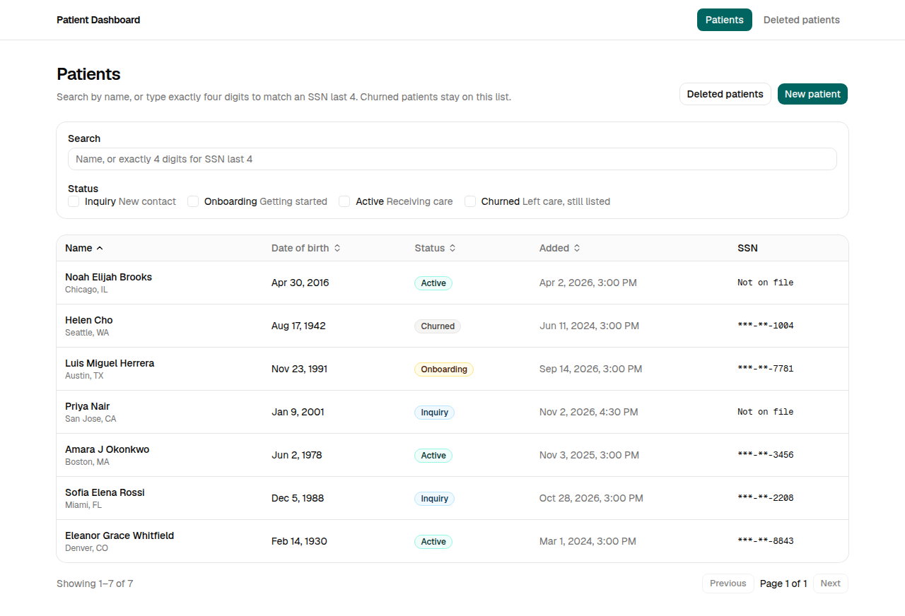
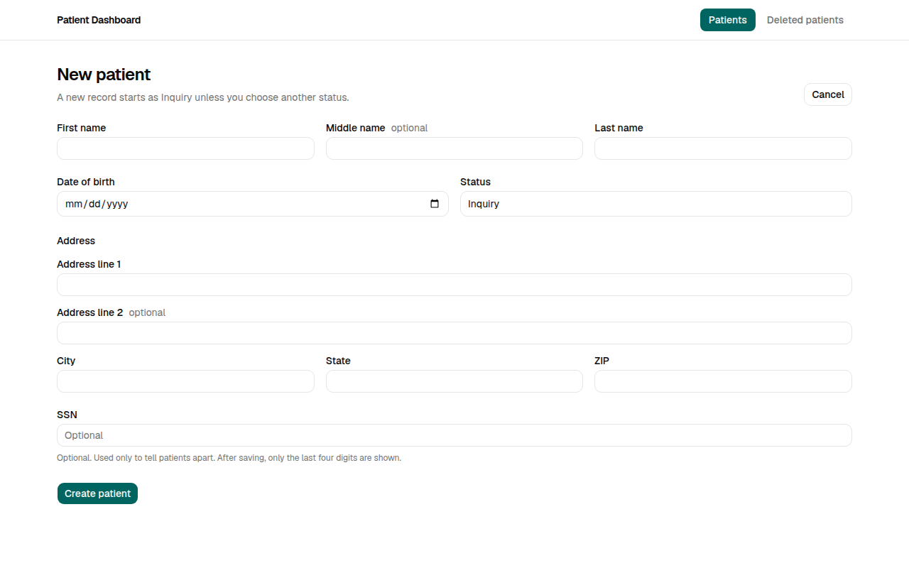
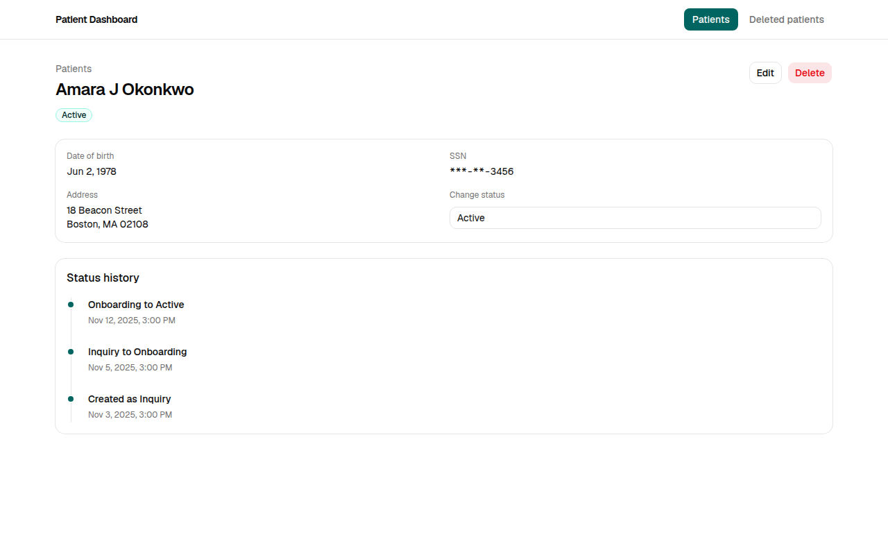
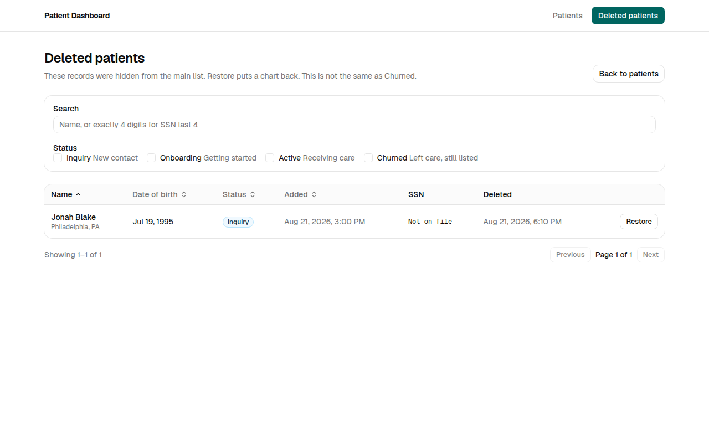
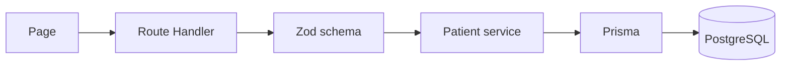

# Patient Dashboard

A patient management dashboard for a single practice. Providers can create, view, and edit patients, search and filter the list, soft-delete a mistaken record and restore it, and read the status history of each chart. A new patient starts as Inquiry and can move to Onboarding, Active, or Churned. Churned stays on the main list; delete only hides the row. Social Security numbers are optional, stored encrypted, and shown only as the last four digits.

## Screenshots

The list, the create form, a chart with its timeline, and the deleted archive.









## Tech stack

| Choice | Why |
| --- | --- |
| Next.js App Router | Pages and Route Handlers live in one tree, so the UI and the API ship together. |
| TypeScript strict | Null SSN fields and the wire types fail the build instead of failing at runtime. |
| Tailwind and shadcn/ui | Utility layout plus a small set of accessible components, without a second design system. |
| Prisma 7 and PostgreSQL | Typed queries, migrations, and transactions. Postgres holds the partial indexes and the status-history foreign key. |
| Zod, shared | The forms and the API import the same schemas, so a value the form accepts is a value the API accepts. |

## Getting started

Node.js 22 or newer, and Docker for local Postgres.

```bash
cp .env.example .env
docker compose up -d
npm install
npm run db:migrate
npm run db:seed
npm run dev
```

Open [http://localhost:3000](http://localhost:3000). `/` redirects to `/patients`.

`docker compose up -d` starts Postgres 16 (`patient` / `patient`, database `patient_dashboard`, port 5432) and returns. `docker compose up` is the same service in the foreground.

`.env.example` has the local `DATABASE_URL` and two placeholder SSN keys. Generate real ones before storing anything that is not sample data. Each key is 32 bytes, base64, and the two values must differ:

```bash
openssl rand -base64 32   # SSN_ENCRYPTION_KEY
openssl rand -base64 32   # SSN_HMAC_KEY
```

Losing the encryption key makes stored SSNs unreadable. Changing the HMAC key makes old rows fail the duplicate check. `npm install` runs `prisma generate` and does not need Postgres. Migrate and seed do need `.env`.

`npm run db:migrate` is `prisma migrate dev` (it can create a migration and needs a shadow database). On a fresh database it applies the committed migration and does not prompt. Do not point it at production; apply committed SQL there with `npx prisma migrate deploy`.

`npm run db:seed` loads eight fictional patients. Five have fake SSNs in the unissued 900–999 range, and one row is soft-deleted. Running it again clears patients and status history, then writes them back.

| Command | What it does |
| --- | --- |
| `npm test` | Vitest. Creates `patient_dashboard_test`, applies migrations with `prisma migrate deploy`, and leaves the dev database alone. |
| `npm run lint` | ESLint. |
| `npm run build` | Production build. |
| `npm run format` | Prettier rewrite. `npm run format:check` only checks. |

## Project structure

```
src/app/page.tsx                         / redirects to /patients
src/app/patients/                        list, new, detail, edit, deleted
src/app/api/patients/                    Route Handlers
src/components/patients/                 list, form, detail, timeline
src/components/ui/                       shadcn/ui primitives
src/lib/patients/schema.ts               Zod schemas (safe to import from the client)
src/lib/patients/service.ts              queries, duplicates, soft delete, history
src/lib/patients/http.ts                 typed errors to 404 / 409 / 422
src/lib/patients/api-client.ts           browser fetch
src/lib/ssn.ts                           AES-256-GCM and HMAC
src/lib/prisma.ts                        shared Prisma client
prisma/schema.prisma                     models
prisma/migrations/                       SQL, including the name + DOB index
prisma/seed.ts                           sample patients
tests/                                   API, UI helpers, and date rules
docs/ASSUMPTIONS.md                      product assumptions
```

## Architecture

A page is a client component. It fetches a Route Handler. The handler parses the request with Zod, calls the patient service, and returns JSON. The service talks to Postgres through Prisma. Pages never import Prisma.

Validation lives in `src/lib/patients/schema.ts`. Create, update, and list queries are parsed there before the service runs. The service throws typed errors (`not found`, SSN duplicate, possible duplicate, validation). `withPatientErrors` maps those to status codes. The create and edit forms import the same schemas, so field errors match the API.



## Data model

`patients` is the chart. `patient_status_history` is one row per status change, including the first change from no status at create. `deleted_at` is the soft delete. An SSN, when present, is stored three ways: AES-256-GCM ciphertext, the last four digits in plaintext, and a keyed HMAC. The HMAC column is unique, and PostgreSQL allows many nulls, so patients without an SSN are fine. Date of birth is a `DATE`.

The live status filter is a partial index (`deleted_at IS NULL`) declared in the Prisma schema. The case-insensitive name + date-of-birth index is raw SQL in the initial migration (`patients_name_dob_active_idx`), because Prisma cannot express that expression index. Leave it in place.

## API

JSON fields are snake_case (`date_of_birth`, `page_size`, `ssn_last4`). Responses never include the full SSN, the ciphertext, or the hash. List responses are `{ data, total, page, page_size }`. Default page size is 20, maximum 100. Sort is `last_name` (default), `date_of_birth`, `created_at`, or `status`, with `asc` or `desc`. A `page_size` over 100 is 422, not clamped.

| Method | Path | Purpose | Status |
| --- | --- | --- | --- |
| `GET` | `/api/patients` | Live patients. `search`, repeated or comma-separated `status`, `sort`, `order`, `page`, `page_size`. | 200, 422 |
| `POST` | `/api/patients` | Create. `?confirm_duplicate=true` accepts a same name and date of birth. | 201, 409, 422 |
| `GET` | `/api/patients/deleted` | Soft-deleted patients. Same query as the live list. | 200, 422 |
| `GET` | `/api/patients/:id` | One live patient. Missing, deleted, or a non-UUID id. | 200, 404 |
| `PATCH` | `/api/patients/:id` | Partial update. Omitted SSN is left alone; `ssn: null` clears it. | 200, 404, 409, 422 |
| `DELETE` | `/api/patients/:id` | Soft delete. Empty body. | 204, 404 |
| `POST` | `/api/patients/:id/restore` | Clear `deleted_at`. Already-live is 200. | 200, 404 |
| `GET` | `/api/patients/:id/status-history` | `{ data }`, newest first. Deleted patients are 404. | 200, 404 |

`422` is `{ errors: { field: message } }`. `409` is either `{ error: "ssn_duplicate", existing_id }` or `{ error: "possible_duplicate", possible_duplicates }`. `404` is `{ error: "not_found" }`.

## Design decisions

Product assumptions are in [docs/ASSUMPTIONS.md](docs/ASSUMPTIONS.md). The trade-offs in the code:

- **SSN.** Ciphertext for storage, last four for display and search, HMAC for uniqueness. The unique index is not partial, so a soft-deleted row still returns 409 for that SSN. `confirm_duplicate` does not override it. The API and the UI never show the full number (`***-**-` plus last four, or "Not on file").
- **Soft delete.** `deleted_at` hides a bad row. Churned is a status and stays visible. Restore is one request. History uses `ON DELETE RESTRICT` so a hard delete cannot drop the trail; the app does not hard-delete.
- **Status history.** The status change and the history row are written in the same transaction, including create (`from_status` null). A chart cannot show a status the timeline cannot explain.
- **Duplicates.** Same SSN is 409 with `existing_id`, including when the other row is deleted. Same first name, last name (case-insensitive), and date of birth among live patients is 409 with `possible_duplicates` unless `confirm_duplicate=true`. That check runs on create only. PATCH checks the SSN and does not re-warn on name and date of birth.
- **Search.** Case-insensitive substring. Each whitespace-separated token must match the first, middle, or last name. A search that is exactly four digits also matches `ssn_last4`. There is no trigram or edit-distance index.
- **List state.** Search, status, sort, order, and page are in the URL, so a filtered list can be shared and the back button restores it. Search is debounced in the UI.
- **Date of birth.** A calendar date in UTC, not a timestamp. It cannot be in the future, and age is completed years with a cap of 130. A February 29 birthday counts as March 1 in a non-leap year. These are not SQL `CHECK`s: `CURRENT_DATE` is not immutable, so Postgres would reject the constraint. The Zod schema enforces them.

## If there were more time

Authentication and roles, then a `provider_id` on every row so queries are scoped to the signed-in practice. An audit log of reads and writes. Trigram or other fuzzy search once substring match is not enough. Production key management and TLS. The compliance list is in [docs/ASSUMPTIONS.md](docs/ASSUMPTIONS.md).
